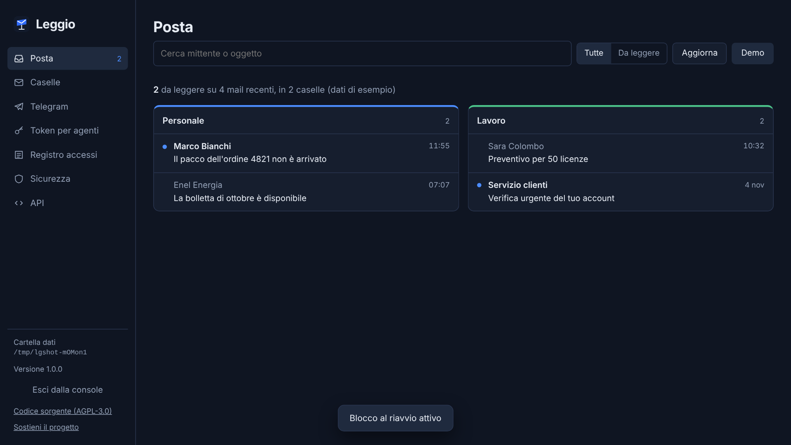

<p align="center"></p>

<h1 align="center">Leggio</h1>

<p align="center"><b>La posta in sola lettura per gli agenti AI.</b><br>Il tuo agente può leggere le tue mail. Non può inviarle, spostarle, cancellarle, né farsi convincere a farlo.</p>

<p align="center"><a href="README.md">English</a> · <a href="#avvio-rapido">Avvio rapido</a> · <a href="#api">API</a></p>

---

Dare a un agente AI la password IMAP significa dargli tutto. Può inviare mail a tuo nome e svuotarti la casella, e basta una mail malevola per convincerlo a farlo. **Leggio** sta nel mezzo: collega le caselle **in sola lettura** e le espone agli agenti con una piccola API REST locale, con token revocabili, un rilevatore di prompt injection e un registro degli accessi. Non esiste un endpoint che scrive, quindi non c'è niente da usare male.

Gira sul tuo computer o sul tuo server. La tua posta non passa da servizi di terzi.

<p align="center"></p>

## Cosa fa

- **Sola lettura per costruzione.** Le caselle si aprono con il comando IMAP `EXAMINE` e i corpi si leggono con `BODY.PEEK`. Leggio non può inviare, rispondere, spostare, cancellare e nemmeno segnare una mail come letta. I test lo verificano su un vero server IMAP.
- **Un token per ogni agente.** È revocabile, può scadere e può essere limitato ad alcune caselle. Viene salvato solo come impronta SHA-256.
- **Segnalazione della prompt injection.** Ogni mail ha un `security.level` (`none`, `medium`, `high`).
  - Leggio cerca istruzioni rivolte a un'AI, anche nascoste: testo nascosto con il CSS, commenti HTML, caratteri a larghezza zero, marcatori da chat-template.
  - Segnala i link il cui testo mostra un sito diverso da quello vero.
  - Ogni mail ha anche `text_for_agent`: il testo racchiuso tra delimitatori che lo dichiarano dato non fidato.
- **Testo pulito.** Le mail solo HTML vengono convertite in testo e le codifiche sbagliate (`Cecília`) vengono corrette (`Cecília`).
- **Registro delle mail già elaborate, per ogni token.** Un agente segna le mail che ha gestito e chiede solo le nuove. Non dipende dallo stato "letta", che cambia quando apri la mail dal telefono.
- **Bot Telegram (facoltativo).**
  - Avvisi di nuove mail, con solo mittente e oggetto.
  - Comandi `/ultime`, `/leggi`, `/cerca` e un riassunto giornaliero.
  - Risponde solo alla tua chat privata. Il testo di una mail arriva su Telegram solo se lo chiedi tu.
- **Password della console, sempre.** Senza, nessuno entra nella console, nemmeno un agente che gira sullo stesso computer: gli agenti hanno solo il loro token. Il primo avvio si conferma con un codice monouso mostrato nella finestra di Leggio, così un programma locale non può prendersi la console prima di te.
- **Blocco al riavvio (facoltativo).** La chiave che cifra le password delle caselle e il token del bot viene protetta dalla password della console: dopo un riavvio nessuno legge la posta finché non entri. Utile sul portatile; da lasciare spento su un server che si riavvia da solo.
- **Una console locale** per collegare le caselle, creare token, leggere le mail in sicurezza (senza script e senza immagini esterne, quindi niente pixel spia) e controllare il registro degli accessi.

## Avvio rapido

Serve [Node.js](https://nodejs.org) **20.19 o successivo**.

```bash
git clone https://github.com/Andreadileo/leggio.git
cd leggio
npm install --omit=dev
npm start
```

Apri **http://localhost:4000**, poi:

1. Scegli la password della console. Il codice di primo avvio è nella finestra di Leggio, e di solito il browser si apre con il codice già inserito.
2. **Caselle**: collega una casella. I preset per Gmail, iCloud, Yahoo, Libero, Aruba e Hostinger spiegano cosa vuole ogni provider (di solito una password per le app).
3. **Token per agenti**: crea un token e dallo al tuo agente.

Su Windows basta un doppio clic su `Avvia Leggio.bat`. Se vuoi un'icona sul Desktop, lancia una volta `Crea icona sul Desktop.bat`.

## API

Indirizzo `http://localhost:4000` · intestazione `Authorization: Bearer <token>`

| Metodo | Percorso | Cosa fa |
|---|---|---|
| `GET` | `/v1/mailboxes` | Le caselle che questo token può vedere |
| `GET` | `/v1/messages?limit=25` | Le ultime mail di tutte le caselle, senza il corpo |
| `GET` | `/v1/messages?mailbox=<id>&unprocessed=1` | Una sola casella, solo le mail che questo token non ha ancora segnato come elaborate |
| `GET` | `/v1/messages/<mailbox_id>/<uid>` | La mail completa: `text`, `text_source`, `html`, `text_for_agent`, `attachments`, `security` |
| `POST` | `/v1/processed` | `{"items":[{"mailbox_id","uid"}]}`: segna le mail come elaborate. Scrive solo nel registro di Leggio, mai nella casella |
| `GET` | `/health` | Stato del servizio |

```bash
curl -H "Authorization: Bearer $LEGGIO_TOKEN" "http://localhost:4000/v1/messages?unprocessed=1"
```

Errori: `401` token mancante, sbagliato, revocato o scaduto · `429` più di 120 richieste al minuto · `503` Leggio bloccato dopo il riavvio (nessuno è ancora entrato nella console) · `502` il server della casella non risponde.

### Come darlo a un agente

Passagli `text_for_agent` invece di `text` e tratta `security.level == "high"` come un segnale di stop: salta la mail o chiedi a una persona. Leggio non può impedire a un agente di *credere* a una mail, ma gli impedisce di *agire* sulla tua casella, e lo avvisa quando una mail sembra provarci.

## Configurazione

| Variabile | A cosa serve | Predefinito |
|---|---|---|
| `LEGGIO_DATA_DIR` | Cartella dati di questa istanza. Due istanze con cartelle diverse non condividono nulla. | `%APPDATA%\Leggio` o `~/Leggio` (l'avvio per Windows usa `%APPDATA%\Leggio-Personale`) |
| `PORT` | Porta dell'API (e della console in modalità locale) | `4000` |
| `HOST` | Indirizzo di ascolto dell'API | `127.0.0.1` |
| `ADMIN_PORT` | Porta della console quando `HOST` non è locale | `PORT + 1` |

Con `HOST=0.0.0.0` l'API ascolta sulla rete, mentre la console resta **sempre** su `127.0.0.1`, su una porta separata. Le richieste che arrivano da un proxy o da un altro sito vengono rifiutate. Esponi l'API solo dietro HTTPS (Caddy, Nginx…).

## Sicurezza: cosa garantisce e cosa no

Cosa Leggio garantisce, per come è costruito:
- Nessuna chiamata API, nessun comando del bot e nessuna azione della console può modificare una casella.
- Password delle caselle e token del bot sono cifrati con AES-256-GCM. Con il blocco al riavvio anche la chiave è protetta dalla password della console (scrypt).
- La console risponde solo a richieste dirette dalla stessa macchina, e solo dopo l'accesso con la password della console.
- I file dei dati vengono scritti in modo atomico.

Cosa non garantisce:
- **Il rilevatore di injection è un'euristica.** Riduce il rischio, non lo elimina.
- **Fai girare gli agenti con un altro utente del sistema, o in una sandbox.** La password della console ferma gli agenti che possono solo fare richieste HTTP. Un programma che gira con il *tuo* utente può leggere direttamente la cartella dati di Leggio, decifrare le password delle caselle e usarle senza passare da Leggio. Nessun programma locale può impedirlo: lo fanno i permessi del sistema operativo.
- **Senza blocco al riavvio** la chiave sta accanto ai dati. Protegge da una copia di `accounts.json`, non da un computer compromesso.
- **La password della console non si recupera.** Se la perdi, cancella la cartella dati e ricollega tutto.
- **Outlook.com e la maggior parte degli account Microsoft 365** non accettano più la password IMAP semplice. Serve OAuth, che Leggio non supporta ancora.
- **Legge solo la cartella Posta in arrivo (INBOX).**
- **Il bot Telegram funziona solo mentre Leggio è acceso.** Per avvisi 24 ore su 24, fallo girare su un server.

Hai trovato una vulnerabilità? Leggi [SECURITY.md](SECURITY.md) e segnalala in privato.

## Test

I test usano un vero server IMAP (Dovecot) e un finto server Telegram. Coprono sola lettura, token, password della console e blocco al riavvio, protezioni della console, segnalazioni di injection e regole di privacy del bot: 70 test in tutto. Su Linux:

```bash
sudo apt-get install -y dovecot-imapd
sudo test/setup-dovecot.sh   # server di prova usa e getta su 127.0.0.1:1143
npm run test:local
```

Girano anche a ogni push, con GitHub Actions.

## Contribuire

Issue e pull request sono benvenute, in italiano o in inglese. Vedi [CONTRIBUTING.md](CONTRIBUTING.md).

## Storia

Creato da Andrea Di Leo a Roma nel luglio 2026, prima con il nome *Relvane*; open source come Leggio dal novembre 2026. Vedi il [changelog](CHANGELOG.md).

## Licenza

[GNU AGPL-3.0](LICENSE) © 2026 Andrea Di Leo.

Puoi usare, modificare e condividere Leggio liberamente. Se offri una versione modificata ad altri via rete, devi pubblicare le tue modifiche con la stessa licenza.

Se Leggio ti è utile, puoi [sostenere il progetto su Ko-fi](https://ko-fi.com/andreadileo).
