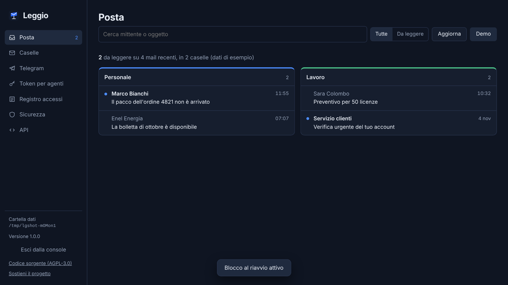

<p align="center"></p>

<h1 align="center">Leggio</h1>

<p align="center"><b>Read-only email for AI agents.</b><br>Your agent can read your mail. It can't send, move, delete, or be talked into it.</p>

<p align="center"><a href="README.it.md">Italiano</a> · <a href="#quick-start">Quick start</a> · <a href="#api">API</a></p>

---

Giving an AI agent your IMAP password gives it everything: it can send mail as you, delete your inbox, and a single malicious email can tell it to do exactly that. **Leggio** sits in between. It connects your mailboxes in **read-only mode** and exposes them to agents through a small local REST API, with revocable tokens, a prompt-injection detector and an access log. There is no endpoint that writes, so there is nothing to misuse.

It runs on your own computer or server. Your mail never goes through a third-party service.

<p align="center"></p>

## What it does

- **Read-only by construction.** Mailboxes are opened with IMAP `EXAMINE` and bodies are fetched with `BODY.PEEK`: Leggio cannot send, reply, move, delete, or even mark a message as read. The tests check this against a real IMAP server.
- **One token per agent.** Tokens are revocable, can expire, can be limited to specific mailboxes, and are stored only as SHA-256 hashes.
- **Prompt-injection flags.** Every message gets a `security.level` (`none`, `medium`, `high`). Leggio looks for instructions aimed at an AI, including text hidden with CSS, HTML comments, zero-width characters and chat-template markers, and for links whose visible text points somewhere else. Each message also comes with `text_for_agent`: the body wrapped in delimiters that mark it as untrusted data.
- **Clean text.** HTML-only mail is converted to text, and broken encodings (`Cecília`) are repaired (`Cecília`).
- **"Already processed" tracking per token.** An agent marks what it has handled and asks only for new mail. It doesn't depend on the read/unread flag, which changes when you open a message on your phone.
- **Optional Telegram bot.** New-mail alerts (sender and subject only), plus `/ultime`, `/leggi`, `/cerca` and a daily digest. It answers only your private chat. A message body reaches Telegram only when you ask for it.
- **A console password, always.** Nobody gets into the console without it, including an agent running on the same machine: agents only ever get their token. The first run is confirmed with a one-time code shown in Leggio's terminal, so a local program can't claim the console before you do.
- **Optional lock on restart.** The key that encrypts mailbox passwords and the bot token is then protected by the console password, and after a restart nothing reads mail until you log in. Good for a laptop; leave it off on a server that restarts on its own.
- **A local console** to connect mailboxes, issue tokens, read mail safely (no scripts, no remote images, so no tracking pixels) and review the access log.

## Quick start

You need [Node.js](https://nodejs.org) **20.19 or newer**.

```bash
git clone https://github.com/Andreadileo/leggio.git
cd leggio
npm install --omit=dev
npm start
```

Open **http://localhost:4000**, then:

1. Choose the console password. The first-run code is shown in Leggio's window, and the browser usually opens with it already filled in.
2. **Caselle** (Mailboxes): connect a mailbox. Presets for Gmail, iCloud, Yahoo, Libero, Aruba and Hostinger tell you exactly what each provider needs (usually an app password).
3. **Token per agenti** (Agent tokens): create a token and give it to your agent.

On Windows you can just double-click `Avvia Leggio.bat` (or run `Crea icona sul Desktop.bat` once to get a desktop shortcut).

> The console is currently in Italian. An English translation is on the roadmap, and contributions are welcome.

## API

Base URL `http://localhost:4000` · header `Authorization: Bearer <token>`

| Method | Path | What it does |
|---|---|---|
| `GET` | `/v1/mailboxes` | Mailboxes this token can see |
| `GET` | `/v1/messages?limit=25` | Latest messages from all mailboxes, without bodies |
| `GET` | `/v1/messages?mailbox=<id>&unprocessed=1` | One mailbox, only messages this token hasn't marked as processed |
| `GET` | `/v1/messages/<mailbox_id>/<uid>` | Full message: `text`, `text_source`, `html`, `text_for_agent`, `attachments`, `security` |
| `POST` | `/v1/processed` | `{"items":[{"mailbox_id","uid"}]}`: marks messages as processed. Writes only to Leggio's own log, never to the mailbox |
| `GET` | `/health` | Service status |

```bash
curl -H "Authorization: Bearer $LEGGIO_TOKEN" "http://localhost:4000/v1/messages?unprocessed=1"
```

`security` looks like `{ "level": "high", "score": 7, "flags": ["hidden_instructions", "exfiltration"], "link_mismatches": [] }`.

Errors: `401` missing, wrong, revoked or expired token · `429` more than 120 requests per minute · `503` Leggio is locked after a restart (nobody has logged into the console yet) · `502` the mail server didn't answer.

### Giving it to an agent

Pass `text_for_agent` rather than `text`, and treat `security.level == "high"` as a stop sign: skip the message or ask a human. Leggio can't stop an agent from *believing* an email, but it can stop it from *acting* on your mailbox, and it tells the agent when an email looks like it's trying.

## Configuration

| Variable | Purpose | Default |
|---|---|---|
| `LEGGIO_DATA_DIR` | Data folder for this instance. Two instances with different folders share nothing. | `%APPDATA%\Leggio` or `~/Leggio` (the Windows launcher uses `%APPDATA%\Leggio-Personale`) |
| `PORT` | API port (and console port in local mode) | `4000` |
| `HOST` | API listen address | `127.0.0.1` |
| `ADMIN_PORT` | Console port when `HOST` is not local | `PORT + 1` |

With `HOST=0.0.0.0` the API listens on the network, but the console **always** stays on `127.0.0.1`, on a separate port. Requests that arrive through a proxy or from another website are rejected. Only expose the API behind HTTPS (Caddy, Nginx…).

## Security model, and its limits

What Leggio guarantees, by design:
- No API route, bot command or console action can change a mailbox.
- Mailbox passwords and the bot token are encrypted with AES-256-GCM. With the lock on restart, the key itself is protected by the console password (scrypt).
- The console answers only direct requests from the same machine, and only after logging in with the console password.
- Data files are written atomically.

What it doesn't:
- **The injection detector is a heuristic.** It lowers the risk; it doesn't remove it.
- **Run agents as a different OS user, or in a sandbox.** The console password stops agents that can only make HTTP requests. A program running as *your* user can read Leggio's data folder directly, decrypt the mailbox passwords and use them without Leggio. No local app can prevent that; operating-system permissions can.
- **Without the lock on restart**, the encryption key sits next to the data. That protects a copied `accounts.json`, not a compromised computer.
- **The console password can't be recovered.** If you lose it, delete the data folder and reconnect everything.
- **Outlook.com and most Microsoft 365 accounts** no longer accept plain IMAP passwords and need OAuth, which Leggio doesn't support yet.
- **Only the INBOX folder** is read.
- **The Telegram bot only runs while Leggio does.** For 24/7 alerts, run it on a server.

Found a vulnerability? Please read [SECURITY.md](SECURITY.md) and report it privately.

## Tests

The tests run against a real IMAP server (Dovecot) and a fake Telegram API. They cover read-only behaviour, tokens, the console password and the lock on restart, console protections, injection flags, and the bot's privacy rules: 70 tests in all. On Linux:

```bash
sudo apt-get install -y dovecot-imapd
sudo test/setup-dovecot.sh   # throwaway test server on 127.0.0.1:1143
npm run test:local
```

They also run on every push via GitHub Actions.

## Project layout

```
server.js         API, console routes, startup
lib-store.js      data folder, atomic writes, encryption, console password
lib-mail.js       HTML-to-text, encoding repair
lib-security.js   prompt-injection detector
lib-telegram.js   Telegram bot
public/           console (no inline scripts, strict CSP)
test/             end-to-end tests
site/             project website
```

## Contributing

Issues and pull requests are welcome, in English or Italian. See [CONTRIBUTING.md](CONTRIBUTING.md).

## License

[GNU AGPL-3.0](LICENSE) © 2026 Andrea Di Leo.

You can use, modify and share Leggio freely. If you offer a modified version to others over a network, you must publish your changes under the same license.

If Leggio is useful to you, you can [support the project on Ko-fi](https://ko-fi.com/andreadileo).
